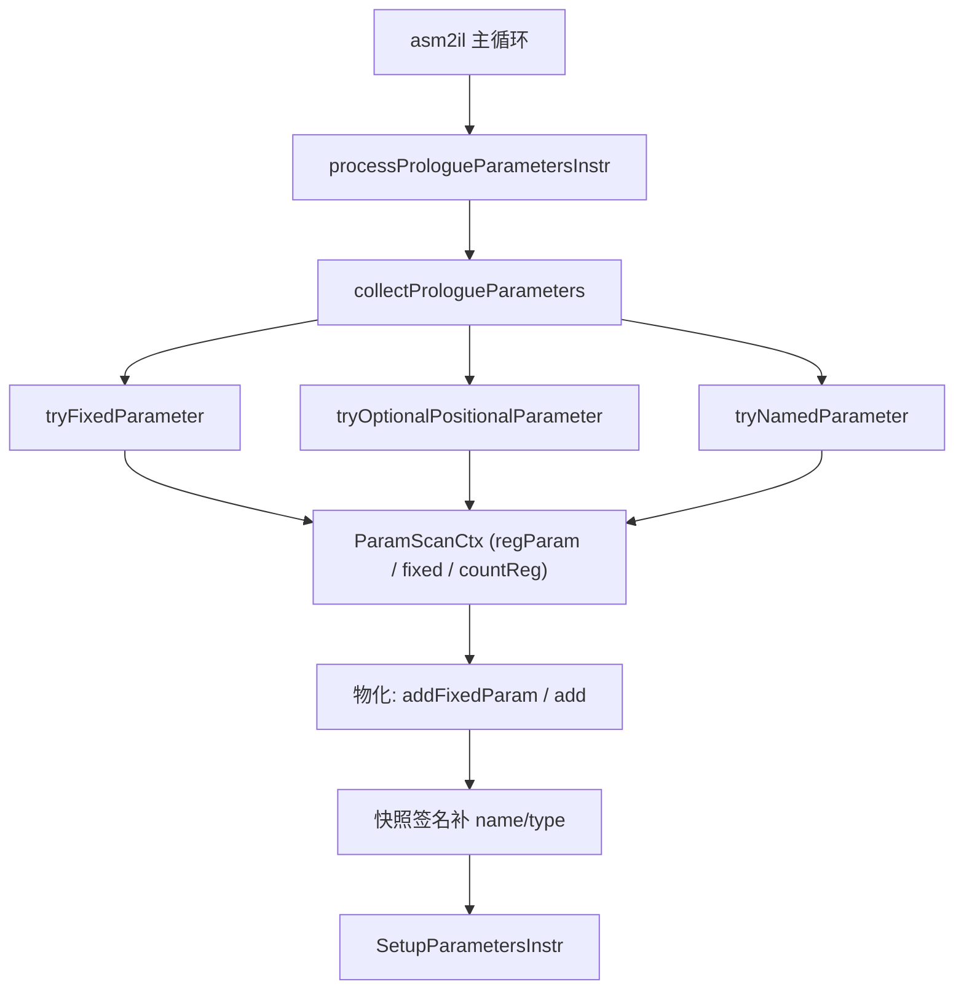

# 设计文档：x64 IL 分析器对齐 arm64

Feature Name: x64-analyzer-parity
Updated: 2026-10-19

## Description

把 arm64 分析器已经成熟的参数 prologue 分析能力对齐到 `CodeAnalyzer_x64.cpp`：识别固定参数、可选位置参数与命名参数，并绑定到 `FnParams`。

实现采用**策略 A：符号解释**。arm64 用逐指令形状匹配即可覆盖，因为其 prologue 由 `PrologueBuilder` 生成、形态稳定；x64 AOT 的同一语义步骤有大量等价形态（参数留在寄存器、spill 到局部槽、经 ArgumentsDescriptor 索引、闭包上下文前置参数等），逐形状匹配会不断漏配。因此 x64 侧改为跟踪“参数个数寄存器来自哪里、ArgumentsDescriptor 在哪里、某寄存器当前承载第几个参数”的符号状态，再按语义步骤消费指令。

x64 与 arm64 共享 IL 层（`FnParams`、`FnParamInfo`、`AnalyzingState`、`AnalyzingVars`），差异只在寻址与寄存器 ABI。

## Architecture



### ParamScanCtx

| 字段 | 含义 |
| --- | --- |
| `fixed[]` | 固定参数槽：`set`、`paramReg`、`valReg`、`localOffset`、`paramOffset`、`name`、`type` |
| `optPos[]` / `optPosIdx[]` | 可选位置参数及其真实参数序号 |
| `named[]` | 命名参数（名称来自 PP 字符串比较） |
| `regParam[16]` | x64 寄存器 → 参数序号（包含 `mov dst, src` 传播） |
| `countReg` / `countKnown` | 实参个数寄存器及其是否已知 |
| `numFixed` | 固定参数个数（`-1` 表示未知） |

## Components and Interfaces

### 1. `collectPrologueParameters`

在 `SetupParameters` 阶段循环调用三个 `try*`，任一步前进即继续；遇到 `cmp SP, [THR+stack_limit]`（CheckStackOverflow）退出。循环上界按 `fnInfo->stackSize` 校验局部偏移，参数序号 clamp 到 64。

### 2. `tryFixedParameter`

按优先级识别三种形态：

1. **寄存器直传**：`mov dst, src`，`src` 已在 `regParam` 中 → 传播参数序号。
2. **参数寄存器**：`mov dst, <argReg>`（`rdi`/`rsi`/`rdx`/`rbx`/`r8`/`r9`）→ 绑定对应序号。
3. **调用者栈读取**：`mov dst, [fp + disp]`（`disp >= 0x10`）→ `idx = disp/8 - 2`；`mov dst, [fp + countReg*4 + disp]` → `idx = numFixed + 1 - disp/8`。闭包同样适用（其参数位于闭包上下文之后）。

命中后登记 `valReg`/`localOffset`，并把 `ValParam(idx)` 写入寄存器与局部状态。

### 3. `tryOptionalPositionalParameter`

识别 `cmp <countReg>, #(i+1)<<1 ; jcc <defaults>`，再匹配 `mov dst, [fp + countReg*4 + 8]` 的取值；未使用参数只登记空槽。参数序号为 `NumFixed() + i`，记录在 `optPosIdx`。

### 4. `tryNamedParameter`

从 `mov reg, [ARGS_DESC + first_named_entry_offset]` 起步，按 `named_entry_size` 步进，用 `LoadField`/字符串比较识别 `name` 与 `position` 字段；名称与 PP 表字符串相等时登记命名参数并推进 `k`。该扫描只消费到名称比较为止，后续分支仍由主循环处理。

### 5. 物化

- 只登记**实际检测到**的固定参数槽（不按签名个数补空位），序号映射与 arm64 一致；未检测的槽不产生伪寄存器标注。
- 快照签名存在时按**槽序号**补 `name`/`type`；可选位置参数按 `optPosIdx` 补；命名参数按名称精确匹配补 `type`。
- 实例方法且首个参数无名称时命名为 `this`，类型取 `Class().DeclarationType()`。

### 6. `handlePrologue` 状态重建

`AnalyzingState` 依赖 `stackSize` 分配局部变量表。`asm2il` 早期构造时 `stackSize=0`，因此在 `AllocStack` 加入 IL 后用真实 `stackSize` 重新 `fnInfo->InitState()`，避免后续访问局部槽越界（崩溃修复点）。

## Data Models

- 参数寄存器顺序：`kCpuRegistersForArgs = {RDI, RSI, RDX, RBX, R8, R9}`（对应 `A64::Register` 索引 `{7,6,2,3,8,9}`）；上下文寄存器 `RDX`。
- 调用者栈布局：`[fp+0x10]` 为第一个固定参数，`[fp+0x8]` 为返回地址，`[fp]` 为旧 `fp`。
- ArgumentsDescriptor 偏移（PRODUCT x64，heap tag=值−1）：`count=0x20→0x1f`、`size=0x28`、`positional_count=0x30`、`first_named_entry=0x38→0x37`、`named_entry_size=0x10`、`name_offset=0x0`、`position_offset=0x8`、`type_args_len=0x18`。全部取自 `dart::` 常量。

## Correctness Properties

1. 检测到的固定参数不少于改动前（对 8896 个函数逐地址对比：0 退化、381 个函数识别出更多参数、25 个函数新增命名参数）。
2. 未检测到的槽不产生参数条目，`SetupParameters` 不带伪 `valReg` 标注。
3. 无签名（混淆）函数不补 name/type，输出保持 `dynamic _`。
4. `FnParams::numFixedParam` 等于实际登记的固定参数个数；命名参数只在检测到 `{...}` 时置 `isNamedParam`。
5. 分析失败只回滚当前模式，不登记半成品参数。

## Error Handling

- prologue 模式不匹配：`try*` 返回 `false`，`AsmIterator` 由 `InsnMarker` 回滚，主循环继续。
- ArgumentsDescriptor 未加载：跳过可选/命名扫描，保留固定参数结果。
- 未知寻址形态：不登记参数，不中断分析。

## Test Strategy

```bash
# 重新构建 x64 分析器
cd /workspace/build/blutter_dartvm3.12.2_windows_x64
ninja

# 分析 Windows x64 样本
cd /workspace
./build/blutter_dartvm3.12.2_windows_x64/blutter_dartvm3.12.2_windows_x64 \
  -i /tmp/opencode/samples/extracted/so_real/app.so \
  -o /tmp/opencode/samples/out_new
```

- 逐函数对比 `out_real`（基线）与 `out_new` 的 `SetupParameters` 参数个数，要求零退化。
- 校验参数个数与函数签名一致（闭包中未在 prologue 使用、仅存在于签名的参数允许缺省）。
- 校验每个命名参数名称都能在同一输出文件的 PP 字符串表中找到。
- 分析器容错基线：`asm2il` 对每条未匹配指令输出 `condition not matched` 日志，2026-10-19 已清零（原 4492 条），可作为后续改动不引入解析退化的快速信号。
- 同批修复的 x64 matcher 缺口（与参数识别无耦合，但影响整函数 IL 完整性）：`A64::Register` 与裸 `x86_reg` 的错误比较、`LoadInt32/Int64FromBoxOrSmi` 的 `movsxd`/`mov` 双倍地址形态、`BoxInt64` 的 `EnterFrame` 包装与 `TMP` 池加载调用。

## References

[^1]: (blutter/src/CodeAnalyzer_x64.cpp) - `ParamScanCtx`、`collectPrologueParameters`、`tryFixedParameter`、`tryOptionalPositionalParameter`、`tryNamedParameter`、`processPrologueParametersInstr`
[^2]: (blutter/src/CodeAnalyzer_arm64.cpp#L954-L1565) - arm64 固定/可选/命名参数蓝本
[^3]: (blutter/src/CodeAnalyzer.h#L70-L140) - `FnParamInfo` / `FnParams`
[^4]: (blutter/src/DartFunction.h#L18-L39) - `DartFunctionSignature`
[^5]: (/workspace/dartsdk/v3.12.2/runtime/vm/constants_x64.h) - x64 参数寄存器与 TAG 常量
[^6]: (.monkeycode/specs/2026-10-06-x64-analyzer-parity/requirements.md) - 本功能需求文档
